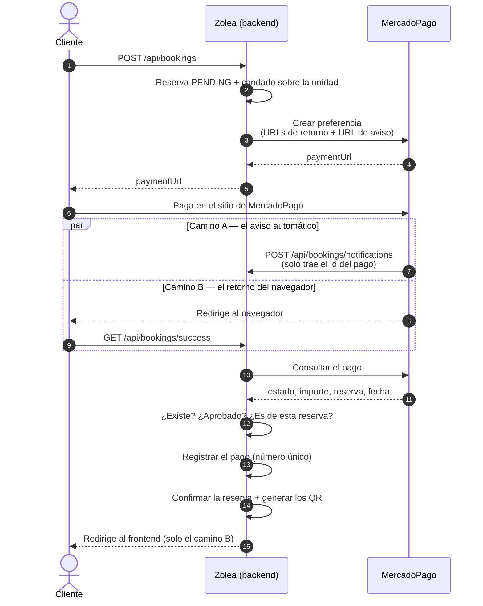

# Flujo de pago

Cómo se cobra una reserva y cómo se confirma, con los dos caminos que existen y por qué son
dos.

La regla que ordena todo el flujo: **nada se confirma por lo que diga una URL.** Lo que llega
por HTTP es apenas un número de pago; el estado real se le pregunta a MercadoPago.

---

## El recorrido completo



## Paso a paso

1. **El cliente reserva.** El backend guarda la reserva como `PENDING`, le pide a MercadoPago
   un link de pago y se lo devuelve. En ese mismo pedido le declara las tres URLs de retorno
   (éxito, pendiente, fallo) **y la URL del aviso automático** (`notificationUrl`). Sin esa
   última no hay aviso y el camino A no existe.
2. **El cliente paga** en el sitio de MercadoPago. El backend no ve datos de la tarjeta.
3. **La confirmación llega por dos caminos independientes**, y con cualquiera alcanza:
   - **Camino A, el aviso automático** (*webhook* o *IPN*): los servidores de MercadoPago
     llaman a `POST /api/bookings/notifications` apenas el pago cambia de estado. No hay
     navegador de por medio, así que funciona aunque el cliente cierre la pestaña.
   - **Camino B, el retorno:** el navegador del cliente vuelve a `GET /api/bookings/success`.
4. **Los dos consultan el pago contra MercadoPago** antes de tocar nada, y comprueban lo
   mismo: que el pago **exista**, que esté **aprobado** y que sea **de esa reserva**.
5. **Se registra el cobro** en `payment` —número, importe, fecha de acreditación y fecha de
   registro— y recién entonces se confirma la reserva y se generan los códigos QR.
6. **En el balneario** se valida el QR, o el DNI si el cliente no lo tiene a mano.

---

## Las decisiones que no se ven en el diagrama

**Por qué hay dos caminos.** El aviso solo se pierde si la pasarela está caída justo en ese
momento; el retorno, si el cliente cierra la pestaña. Que fallen los dos a la vez es bastante
menos probable que cualquiera de las dos cosas por separado. Como **ninguno de los dos
confirma sin preguntar**, tener dos no agrega riesgo: agrega una segunda oportunidad.

**Por qué los dos endpoints son públicos.** Quien los llama es MercadoPago —sus servidores en
el camino A, el navegador que vuelve de su sitio en el camino B— y ninguno de los dos tiene el
token de la aplicación. Que sean públicos es seguro justamente porque no le creen a lo que les
llega.

**Por qué el retorno comprueba una cosa más.** En el camino B el número de reserva viene en la
URL, que la escribe el navegador: hay que verificar que el pago sea realmente de esa reserva.
Sin esa comprobación alcanzaría con reutilizar el comprobante de cualquier pago aprobado
—uno propio, de una reserva de $1— para confirmar otra. En el camino A **no llega ningún
número de reserva**: se toma el del propio pago, que lo informa la pasarela. No hay nada que
comparar porque no hay nada que el que avisa haya podido elegir.

**Por qué el aviso responde siempre 200, incluso cuando no confirma.** Un código de error hace
que MercadoPago reintente, y reintentar no arregla un aviso de un pago rechazado ni uno que no
es de un pago: solo genera ruido. La contrapartida conocida es que si la pasarela está caída
justo en ese momento, ese aviso se pierde — y ahí queda el camino B.

**Qué pasa con un pago que llega tarde.** El link de pago vence a la hora de creada la reserva,
pero la limpieza automática recién cancela la reserva a partir de los 75 minutos (corre cada 5,
así que entre los 75 y los 80). Ese margen es para el pago que se empezó antes de la hora y
MercadoPago aprueba un poco después: la reserva todavía está pendiente y se confirma normalmente.
Si el pago se aprueba cuando la reserva ya está cancelada —por ejemplo, una tarjeta que quedó en
revisión y se aprueba horas después—, el pago **se registra igual**, con su reserva, y la reserva
sigue cancelada. Queda un aviso en el log del backend («Reintegro manual», con el número de pago y
la reserva) para devolverlo a mano desde MercadoPago, y al aviso automático se le responde 200
para que no lo reintente. Si el que vuelve es el navegador, se lo manda a «pago pendiente», sin
error.

**Por qué el registro va antes de la confirmación.** Es lo que hace que dos avisos
**simultáneos** no generen dos juegos de códigos QR. Está explicado en
[decisiones.md](decisiones.md#8-el-pago-se-registra-antes-de-confirmar-la-reserva).

---

## Probarlo en una máquina de desarrollo

MercadoPago necesita una dirección pública HTTPS a la que llamar, y `localhost` no lo es. En local
se resuelve con un túnel de ngrok, y el cobro se hace en el modo prueba de MercadoPago: con la
aplicación de Zolea, una cuenta compradora de prueba y tarjetas de prueba. No se mueve plata real.

### 1. ngrok, una vez por integrante

Cada uno usa su propia cuenta gratis de [ngrok](https://ngrok.com). La cuenta gratis trae un
dominio fijo, así que la dirección del túnel es siempre la misma y se configura una sola vez.

1. Crear la cuenta e instalar ngrok.
2. Registrar el token de la cuenta, que está en el panel de ngrok («Your Authtoken»):

   ```bash
   ngrok config add-authtoken <tu-token-de-ngrok>
   ```

3. Abrir el túnel al backend:

   ```bash
   ngrok http 8080
   ```

   La línea «Forwarding» muestra la dirección https de tu dominio fijo. Si no es la del dominio
   que figura en el panel, se la indicás: `ngrok http --url=https://<tu-dominio> 8080`.

### 2. El `.env`

Va en la raíz del repositorio y no se versiona: está en `.gitignore`. Para el cobro hacen falta
tres variables:

```properties
MP_ACCESS_TOKEN=<access-token-de-prueba>
NGROK_BASE_URL=https://<tu-dominio-de-ngrok>
FRONTEND_URL=http://localhost:4200
```

- `MP_ACCESS_TOKEN`: el Access Token de prueba de la aplicación de Zolea en MercadoPago (Tus
  integraciones → la aplicación → Credenciales, en el entorno de Prueba). Se pasa por privado:
  nunca va al repositorio, a Jira ni a un grupo.
- `NGROK_BASE_URL`: la dirección https del túnel, sin barra al final. Con ella el backend arma
  solo las direcciones de retorno y la del aviso.
- `FRONTEND_URL`: donde corre Angular.

El backend lee el `.env` al arrancar: si lo cambiás, hay que reiniciarlo.

### 3. La cuenta compradora de prueba

Se crea en Tus integraciones → la aplicación de Zolea → Cuentas de prueba, de tipo **Comprador** y
de Argentina. Tiene que ser otra cuenta que la que vende: nadie se puede comprar a sí mismo. La
aplicación admite hasta 15 cuentas de prueba, así que puede haber una por integrante. Quien
administra la aplicación la crea y le pasa por privado el usuario, la contraseña y el código de
verificación que muestra la tabla.

### 4. No hace falta sumar a nadie en MercadoPago

Para probar alcanza con el Access Token de prueba y una cuenta compradora. No hay que invitar a
nadie como colaborador de la aplicación.

### 5. Arrancar, en este orden

Cada uno en su terminal:

```bash
docker compose up -d db
./mvnw spring-boot:run
ngrok http 8080
cd frontend && npm start
```

### 6. La compra

1. Abrir una **ventana de incógnito**, así MercadoPago no toma una cuenta real que esté abierta en
   el navegador.
2. Entrar a `http://localhost:4200` como `santi.rodriguez@gmail.com` (contraseña `admin123`),
   elegir un balneario y reservar. Zolea manda a MercadoPago en la misma ventana.
3. En MercadoPago, entrar con la cuenta compradora de prueba. Si pide un código por mail, es el
   código de verificación de 6 dígitos de esa cuenta, el de la tabla de Cuentas de prueba.
4. Pagar con una de las
   [tarjetas de prueba de MercadoPago](https://www.mercadopago.com.ar/developers/es/docs/your-integrations/test/cards).
   El resultado lo decide el nombre del titular:

   | Titular | Documento | Resultado |
   |---|---|---|
   | `APRO` | DNI 12345678 | Aprobado |
   | `CONT` | — | Pendiente |
   | `OTHE` | DNI 12345678 | Rechazado |

### 7. La vuelta

Después de pagar, MercadoPago devuelve el navegador al backend por el túnel. La cuenta gratis de
ngrok muestra primero un aviso propio («You are about to visit…»): se toca **Visit Site** y sigue.
Ese aviso sale solo en el navegador; al aviso automático de MercadoPago, que llega de servidor a
servidor, no le afecta.

### 8. Por qué cada uno con su túnel

Cada link de pago lleva adentro la dirección del aviso del backend que lo creó, armada con su
`NGROK_BASE_URL`. Así cada integrante recibe los avisos de sus propias compras, y no hay que
configurar nada en el panel de MercadoPago.

### 9. Qué verificar

- Con `APRO`, la reserva pasa a confirmada y su detalle (`http://localhost:4200/bookings/<id>`)
  muestra los QR.
- El pago queda registrado en la tabla `payment`:

  ```bash
  docker exec zolea-mysql mysql -uroot -proot zolea_db -e "SELECT id_booking, gateway_payment_id, status, amount FROM payment"
  ```

- El checkout no ofrece pagar en efectivo (Rapipago, Pago Fácil), y el link vence a la hora de
  creada la reserva: pasado ese plazo, MercadoPago ya no deja pagarlo.
- Sin pagar, pasada la hora pedir un link nuevo responde `400` «La reserva venció.», y la
  limpieza cancela la reserva entre los 75 y los 80 minutos de creada.
- Hasta que esté la pantalla de vuelta del pago (11.2), la vuelta cae en una página provisoria
  («Pago confirmado»), pero la reserva se confirma igual: se ve en su detalle.

**Sin ngrok igual se puede probar el flujo entero**: las pruebas automáticas
(`VerifiedPaymentTest`, `PaymentNotificationTest`, `PaymentRecordTest`) sustituyen la pasarela
por una implementación de mentira y no necesitan red. Eso es exactamente para lo que existe la
interfaz `PaymentGateway`.
